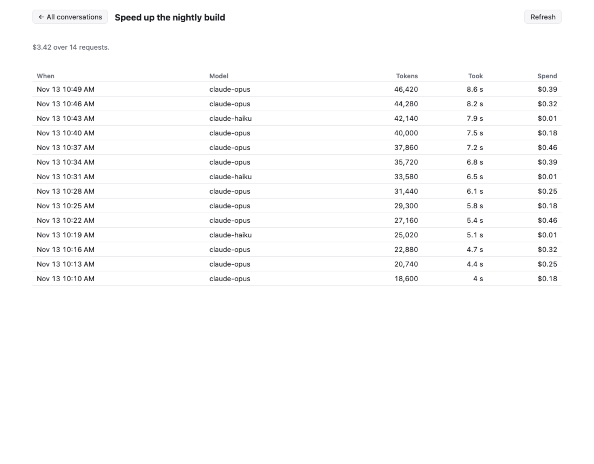

# LiteLLM

A [Mirador](https://github.com/sodre90/mirador) plugin for profiles whose agent talks to a [LiteLLM](https://github.com/BerriAI/litellm) proxy. It shows what you spent through the proxy in the statusline, puts the conversation's own spend in place of the agent's estimate, and has a window of its own with the proxy's figures.


## Set it up

In Mirador's **Profiles**, open a profile's **Plugins** tab and turn on **Uses a LiteLLM gateway**.

- **Gateway URL** and **Access key**: left empty, they read `ANTHROPIC_BASE_URL` and `ANTHROPIC_AUTH_TOKEN` from the profile's Launch environment, which is where a Claude Code profile on a proxy already has them. `$NAME` reads another variable of that environment, such as `$LLM_GATEWAY_KEY`. An OpenAI-style address ending in `/v1` works too.
- **Test connection** asks the proxy with what the form holds, saved or not, and says which key it reached it with and what you spent today.
- Each figure of the statusline has its own switch.


## What it shows

- **Today, Week and Month**: what your user spent through the proxy on every key of theirs, from the proxy's daily activity. Days are the proxy's own UTC days; a week starts on Monday. A key that belongs to no user counts only itself.
- **Session**: what this conversation spent. Claude Code sends the proxy its session id with each request, and the proxy logs it, so the plugin adds up the requests of every session the conversation had: going back to an earlier message, clearing the context or moving to another profile starts a new one. The chip shows once the proxy logged a request of the conversation's, and its figure then stands for the conversation's cost, in place of the agent's estimate, in the statusline and in what your own statusline command reads as `cost.total_cost_usd`.
- A figure that couldn't be refreshed shows dimmed, and its tooltip says as of when and why.

The plugin asks the proxy at most once a minute for the totals and every 30 seconds for the conversation, and again once a turn ends; it asks nothing while no statusline or window shows.

## The window

Click a chip, or open **LiteLLM** from the palette: today's, this week's and this month's totals, the last 30 days day by day, this month by model, and Mirador's conversations on the proxy. A conversation lists its requests: when, which model, tokens, how long it took and what it cost. **Open LiteLLM UI** opens the proxy's own pages.




## The key

The access key stays on the computer Mirador runs on, and goes only to the proxy. Like a profile's environment, it reaches only Mirador's own pages that edit profiles, not the phone, and never the window, the statusline or the host's log.

Needs Mirador's plugin API 14, which brought profile settings to type and toggle, and statusline chips.

## Develop

```bash
bun install
bun run typecheck
bun run test     # unit tests, against a stand-in proxy
scripts/e2e.sh   # e2e in a Mirador test host from MIRADOR_DIR, with Mirador's Playwright
MIRADOR_SCREENSHOTS=1 scripts/e2e.sh e2e/screenshots.spec.ts                            # retakes the light screenshots
MIRADOR_SCREENSHOTS=1 SCREENSHOT_SCHEME=dark scripts/e2e.sh e2e/screenshots.spec.ts     # and the dark ones
```

`MIRADOR_DIR` is Mirador's checkout, by default `../visualized-claude-sessions`.
