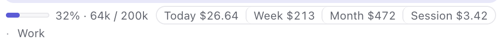
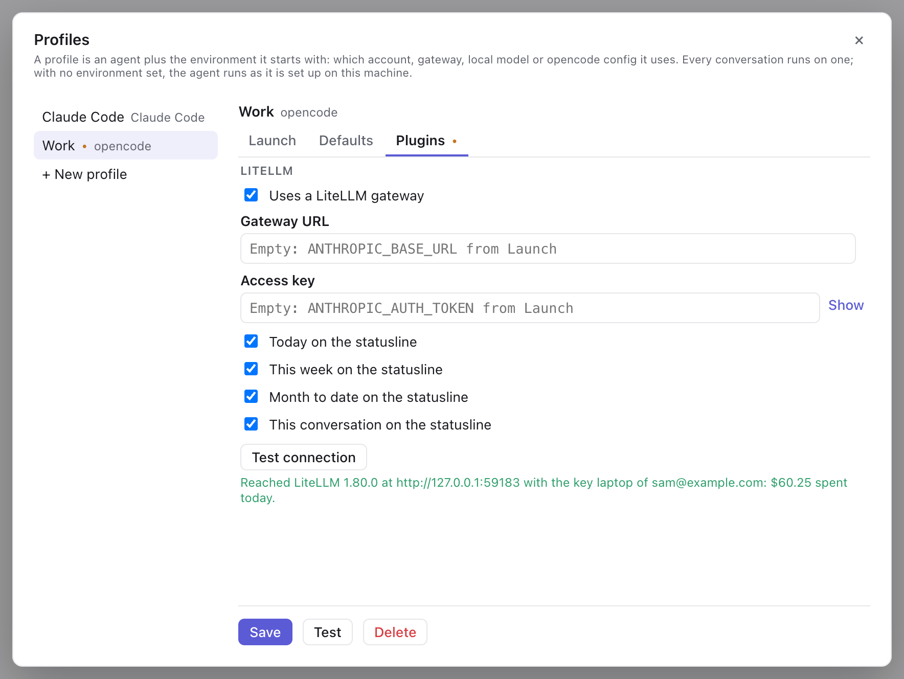
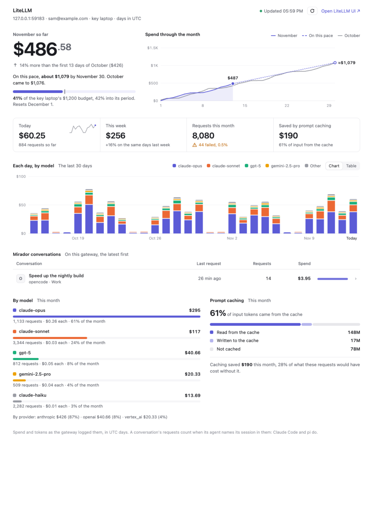

# LiteLLM

A [Mirador](https://github.com/sodre90/mirador) plugin for profiles whose agent talks to a [LiteLLM](https://github.com/BerriAI/litellm) proxy. It shows what you spent through the proxy in the statusline, puts the conversation's own spend in place of the agent's estimate, and has a window of its own with the proxy's figures.



## Set it up

In Mirador's **Profiles**, open a profile's **Plugins** tab and turn **LiteLLM** on. Off, the profile's conversations get nothing of the plugin.

- **Gateway URL** and **Access key**: left empty, they read `ANTHROPIC_BASE_URL` and `ANTHROPIC_AUTH_TOKEN` from the profile's Launch environment, which is where a Claude Code profile on a proxy already has them. `$NAME` reads another variable of that environment, such as `$LLM_GATEWAY_KEY`. An OpenAI-style address ending in `/v1` works too. While the gateway is on and either one reads nothing, the profile's Plugins tab says LiteLLM needs setup.
- **Test connection** asks the proxy with what the form holds, saved or not, and says which key it reached it with and what you spent today.
- Each figure of the statusline has its own switch.



## What it shows

- **Today, Week and Month**: what your user spent through the proxy on every key of theirs, from the proxy's daily activity. Days are the proxy's own UTC days; a week starts on Monday. A key that belongs to no user counts only itself.
- **Session**: what this conversation spent. Claude Code and opencode send the proxy their session id with each request, and so does pi with the extension below; the proxy logs it, so the plugin adds up the requests of every session the conversation had: going back to an earlier message, clearing the context or moving to another profile starts a new one. The chip shows once the proxy logged a request of the conversation's, and its figure then stands for the conversation's cost, in place of the agent's estimate, in the statusline and in what your own statusline command reads as `cost.total_cost_usd`.
- A figure that couldn't be refreshed shows dimmed, and its tooltip says as of when and why.

### pi

pi's own session headers aren't ones LiteLLM reads, so without help each of its requests lands in a session of its own and the conversation shows as not linked. [`pi/litellm-session.ts`](pi/litellm-session.ts) is a pi extension that sends pi's session id as `x-litellm-session-id`. Copy it into the `extensions` folder of the profile's pi agent folder: `~/.pi/agent/extensions/`, or the folder `PI_CODING_AGENT_DIR` names in the profile's Launch environment. Conversations started after that are linked; requests sent before can't be.

The plugin asks the proxy at most once a minute for the totals and every 30 seconds for the conversation, and again once a turn ends; it asks nothing while no statusline or window shows.

## The window

Click a chip, or open **LiteLLM** from the palette.

- **This month**: what you spent so far against the same days of last month, where this pace ends the month, and the key's budget when it has one.
- **At a glance**: today with its last two weeks, this week against the same days of last week, the month's requests and how many failed, and what prompt caching saved.
- **Each day, by model**: the last 30 days, each day split by the four models you spent the most on. Hover a day for its figures, or switch to the table.
- **Mirador conversations** on the proxy, the latest first, with their agent, last request and spend. A conversation whose agent doesn't name its session in its requests shows as not linked.
- **By model** and **Prompt caching**, this month.

A conversation's page shows its spend over time, its input and how much of it came from the cache, its output and time to first token, and each request, a failed one with the reason the proxy gave. **Open LiteLLM UI** opens the proxy's own pages. The window follows Mirador's light or dark look.




## The key

The access key stays on the computer Mirador runs on, and goes only to the proxy. Like a profile's environment, it reaches only Mirador's own pages that edit profiles, not the phone, and never the window, the statusline or the host's log.

Needs Mirador's plugin API 19, which lets the gateway's toggle be the plugin's switch for a profile; API 14 brought profile settings to type and toggle, and statusline chips.

## Develop

```bash
bun install
bun run typecheck
bun run test     # unit tests, against a stand-in proxy
scripts/e2e.sh   # e2e in a Mirador test host from MIRADOR_DIR, with Mirador's Playwright
MIRADOR_SCREENSHOTS=1 scripts/e2e.sh e2e/screenshots.spec.ts                            # retakes the light screenshots
MIRADOR_SCREENSHOTS=1 SCREENSHOT_SCHEME=dark scripts/e2e.sh e2e/screenshots.spec.ts     # and the dark ones
```

`MIRADOR_DIR` is Mirador's checkout, by default `../visualized-claude-sessions`.
